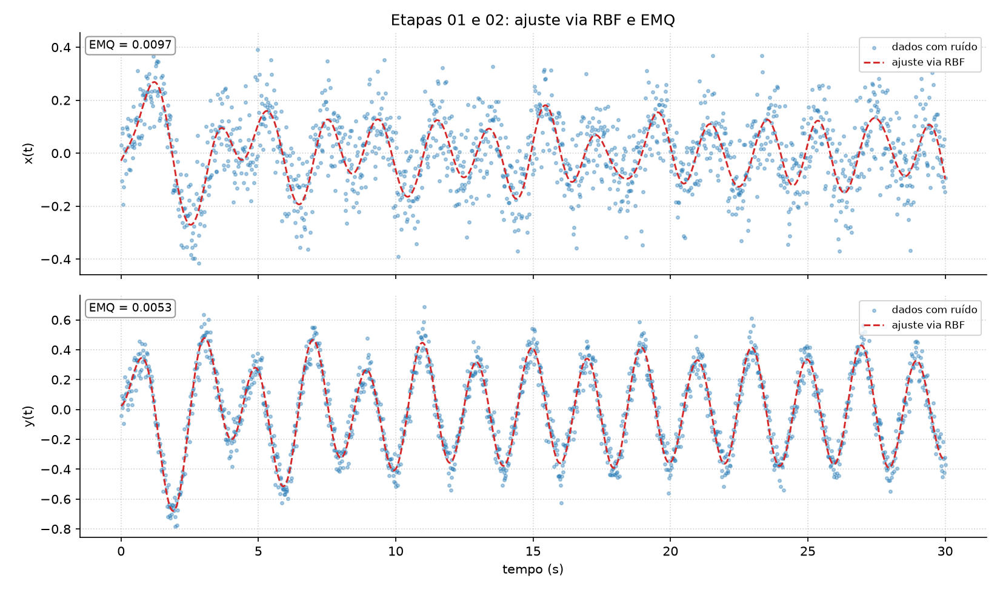

# Identificação de um sistema dinâmico: RBF × MMQ

Projeto da Unidade II de **ECT3401 Computação Numérica** (UFRN), prof. Joilson B. A. Rego.

A partir de medições com ruído de um sistema (uma entrada `u` e duas saídas), o projeto ajusta
dois modelos matemáticos e compara os resultados:

1. **RBF**: soma de funções gaussianas ao longo do tempo, que filtra o ruído do sinal.
2. **MMQ**: o modelo dinâmico `y[n] = w0 + w1·y[n-1] + w2·y[n-2] + w3·u[n] + w4·u[n-1]`,
   com os pesos obtidos pela equação normal (pseudo-inversa) e conferidos por gradiente descendente.

Para cada modelo são calculados o Erro Médio Quadrático (EMQ), RMSE, MAE, a regressão linear
entre os dados medidos e os ajustados e o coeficiente de correlação de Pearson.

O mesmo código roda em dois conjuntos de dados:

| Conjunto | Entrada `u` | Saídas | Comando |
|---|---|---|---|
| Genérico (do professor) | onda quadrada ±1 | `x` e `y` | `python main.py` |
| Temperatura da CPU (Eng. de Computação) | carga de 100% ligada/desligada a cada 30 s | temperatura (°C) e ventoinha (rpm) | `python main.py cpu` |



## Como rodar

```bash
python3 -m venv .venv
source .venv/bin/activate
pip install -r requirements.txt
python main.py        # dados genéricos → resultados/
python main.py cpu    # temperatura da CPU → resultados_cpu/
```

Para coletar novos dados da CPU (Linux, cerca de 12 min, com o carregador ligado):

```bash
python coletar_cpu.py
```

## Resultados (todos os pontos)

Dados genéricos:

| Modelo | EMQ x | r x | EMQ y | r y |
|---|---|---|---|---|
| RBF (M = 50 gaussianas) | 0,0097 | 0,727 | 0,0053 | 0,968 |
| MMQ, previsão de um passo | 0,0123 | 0,635 | 0,0075 | 0,954 |
| MMQ, simulação livre | 0,0150 | 0,520 | 0,0195 | 0,878 |

Temperatura da CPU:

| Modelo | EMQ temperatura (°C²) | r temperatura | EMQ ventoinha (rpm²) | r ventoinha |
|---|---|---|---|---|
| RBF (M = 300 gaussianas) | 3,63 | 0,973 | 168 | 0,999 |
| MMQ, previsão de um passo | 5,38 | 0,960 | 416 | 0,998 |
| MMQ, simulação livre | 29,2 | 0,754 | 31 946 | 0,880 |

## Arquivos

| Arquivo | O que faz |
|---|---|
| `main.py` | Roda todas as etapas em ordem, para o conjunto escolhido |
| `dados.py` | Lê os CSVs (o do professor usa vírgula decimal) |
| `modelos.py` | Matrizes de projeto da RBF e do MMQ, equação normal, simulação e gradiente descendente |
| `metricas.py` | EMQ, RMSE, MAE, Pearson e regressão linear, implementados com as fórmulas |
| `graficos.py` | Gera as figuras |
| `coletar_cpu.py` | Liga e desliga carga na CPU e registra temperatura e ventoinha |
| `dados/` | `dados_projeto_02.csv` (professor) e `dados_cpu.csv` (coletado) |
| `resultados/`, `resultados_cpu/` | Figuras e `resultados.txt` de cada conjunto |
