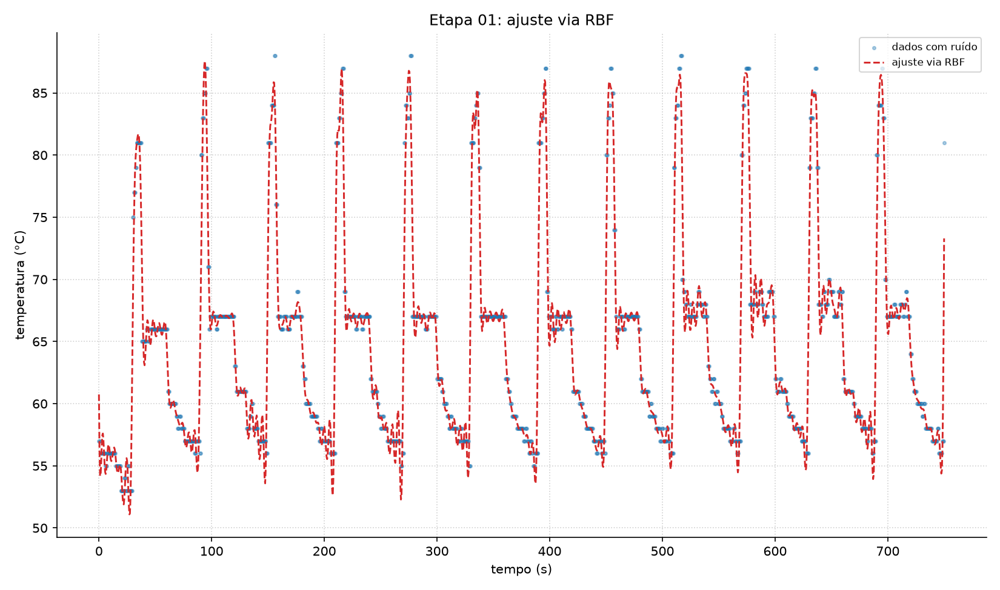

# Identificação da temperatura da CPU: RBF × MMQ

Projeto da Unidade II de **ECT3401 Computação Numérica** (UFRN), prof. Joilson B. A. Rego.

O sistema identificado é o próprio notebook: a entrada `u` é uma carga de 100% na CPU, ligada e
desligada a cada 30 s, e a saída é a temperatura do processador (°C), medida com ruído. O projeto
ajusta dois modelos matemáticos e compara os resultados:

1. **RBF**: soma de funções gaussianas ao longo do tempo, que filtra o ruído do sinal.
2. **MMQ**: o modelo dinâmico `y[n] = w0 + w1·y[n-1] + w2·y[n-2] + w3·u[n] + w4·u[n-1]`,
   com os pesos obtidos pela equação normal (pseudo-inversa) e conferidos por gradiente descendente.

Para cada modelo são calculados o Erro Médio Quadrático (EMQ), RMSE, MAE, a regressão linear
entre os dados medidos e os ajustados e o coeficiente de correlação de Pearson.



## Como rodar

```bash
python3 -m venv .venv
source .venv/bin/activate
pip install -r requirements.txt
python main.py        # análise → resultados/
```

Para coletar novos dados da CPU (Linux, cerca de 12 min, com o carregador ligado):

```bash
python coletar_cpu.py
```

## Resultados (todos os pontos)

| Modelo | EMQ (°C²) | r |
|---|---|---|
| RBF (M = 300 gaussianas) | 3,63 | 0,973 |
| MMQ, previsão de um passo | 5,38 | 0,960 |
| MMQ, simulação livre | 29,2 | 0,754 |

## Arquivos

| Arquivo | O que faz |
|---|---|
| `main.py` | Lê os dados e roda todas as etapas do enunciado em ordem |
| `modelos.py` | Matrizes de projeto da RBF e do MMQ, equação normal, simulação e gradiente descendente |
| `metricas.py` | EMQ, RMSE, MAE, Pearson e regressão linear, implementados com as fórmulas |
| `graficos.py` | Gera as figuras |
| `coletar_cpu.py` | Liga e desliga carga na CPU e registra a temperatura (e a ventoinha, que não é usada) |
| `dados/dados_cpu.csv` | Dados coletados |
| `resultados/` | `fig01` a `fig06` (as figuras do enunciado, na ordem), `extra_*` e `resultados.txt` |
| `relatorio/relatorio_cpu.pdf` | Relatório |
